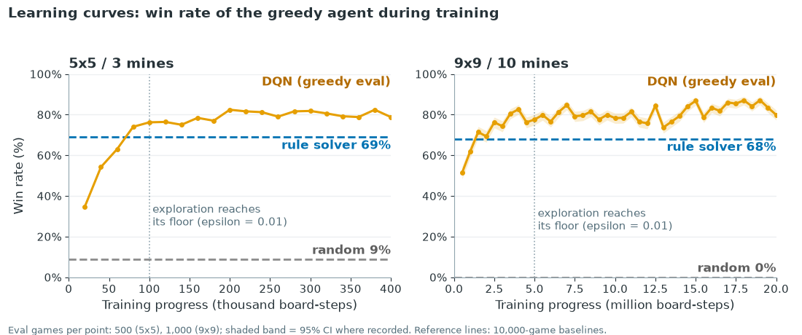

# MineSweeperAI

[](https://github.com/apih99/MineSweeperAI/actions/workflows/ci.yml)

**A Double-DQN agent that learns Minesweeper from scratch, with a fully convolutional network that plays any board size.**

**[Live demo: watch the agent play, or play yourself with hints](https://apih99.github.io/MineSweeperAI/)** (runs in your browser, no server)

- **9x9 / 10 mines: 86.6% win rate** (95% CI 85.9-87.2%) vs 68.1% for a hand-written deduction solver and ~0% for random clicking.
- **Zero-shot transfer:** the same weights, never trained on anything bigger, win **56.6%** of 16x16 / 40-mine games (rule solver: 36.7%).
- Trained in **~37 minutes on a free Kaggle T4**. Win rates are over 10,000 fixed-seed games.


*Left: the board as a player sees it. Right: the network's Q-value for every hidden cell (brighter = it thinks that cell is safer). The orange box is the cell it reveals next. Seed 5,000,000, never seen in training.*

## Results

Win rate over 10,000 games, 95% Wilson CI. Standard seeds are 1,000,000-1,009,999; unseen seeds are 5,000,000-5,009,999 (never used for training, model selection or learning-curve evals). The DQN rows use the `best.pt` checkpoint.

| Board | Random | Rule solver | DQN (standard seeds) | DQN (unseen seeds) |
|-------|--------|-------------|----------------------|--------------------|
| 5x5 / 3 mines | 8.82% (8.28-9.39%) | 68.96% (68.05-69.86%) | **79.93%** (79.13-80.70%) | - |
| 9x9 / 10 mines | 0.00% (0.00-0.04%) | 68.11% (67.19-69.02%) | **86.55%** (85.87-87.20%) | **87.57%** (86.91-88.20%) |
| 16x16 / 40 mines, **DQN trained on 9x9 only** | 0.00% (0.00-0.04%) | 36.69% (35.75-37.64%) | **56.63%** (55.66-57.60%) | - |
| 5x5 / 3 mines, DQN trained on 9x9 only | - | - | 79.09% (78.28-79.88%) | - |


Two caveats. First, `best.pt` is the checkpoint with the best 1,000-game eval during training, picked from 40 noisy evals on seeds that overlap the standard range, so the unseen-seed column is the fairer estimate. Second, the final checkpoint (`final.pt`, 20M steps) scores 79.50% / 80.05% (standard / unseen): late in training the eval win rate bounces between about 74% and 87% because the learning rate never decays. So the honest 9x9 summary is "about 87% at its best checkpoint, about 80% at the end"; see [what I learned](#what-i-learned).

## How it works

- **Environment.** Classic rules, reveal-only (no flags). The first click is always safe: mines are placed after it. Revealing a zero flood-fills. A single-board Gymnasium env is the reference; a vectorised NumPy env steps 256 boards at once and is tested to be bit-for-bit identical to it.
- **Observation.** A 10-channel one-hot grid: channel 0 = hidden, channels 1-9 = revealed number 0-8. Zero padding makes "off the board" look different from every real cell.
- **Action masking.** Already-revealed cells get Q = -inf both when acting and in the Double-DQN target's argmax, and random exploration only picks hidden cells. The agent can never waste a move or bootstrap from an illegal one.
- **Reward.** +1 win, -1 loss, +0.3 per safe reveal, nothing for the guaranteed-safe first click. Rewarding every safe reveal keeps the signal dense even though wins are rare early on.
- **Algorithm.** Double DQN (the online net picks the action, the target net scores it), replay buffer, epsilon-greedy decaying from 1.0 to 0.01 over the first quarter of training. **gamma = 0.1.** Minesweeper is nearly myopic: a move's value is mostly "is this cell safe, and how much does it open?", and the +0.3 per reveal already pays for progress, so a short horizon should train faster and more stably. That is a design bet, not a measured result; the gamma sweep (including 0) is a planned experiment.
- **Network.** Five 3x3 conv layers with 64 channels, then a 1x1 conv down to one channel: one Q-value per cell. No fully connected layers, no batch norm, about 150k parameters. Every layer is convolutional, so the same weights run on any board size; that is why the 9x9 model can be pointed at a 16x16 board unchanged. Five 3x3 layers see an 11x11 neighbourhood, plenty for Minesweeper's local deductions.
- **Training.** 20M board-steps on 256 parallel boards at about 9k board-steps/s on a Kaggle T4 (the NumPy env on the CPU is the bottleneck, not the GPU): **37 minutes** end to end.

## Learning curves



On both boards the agent passes the rule solver early (5x5 around 80k board-steps, 9x9 within about 2M) and then plateaus. The 9x9 curve is noisy because each point is a 1,000-game eval of a constant-learning-rate network.

## Watching it play (and lose)

The agent loses roughly 13% of 9x9 games. This loss is the first one on the unseen seeds, not a hand-picked one:


Here the agent never had a certainly-safe move: from the first moves on, the rule solver's two deduction rules find no safe cell at any of the 12 moves, and the Q-heatmap is a flat plateau of similar values (the fatal cell was among the best of them, about 0.3). Across 10,000 unseen-seed games ([results/dqn/loss_analysis_9x9_10.json](results/dqn/loss_analysis_9x9_10.json), `scripts/analyze_losses.py`) the agent lost 1,243 games, and in 1,123 of them (90%) the rule solver could not have found a safe cell at the fatal click either, so most losses are guesses. The other 120 (10%) are real misses. This only checks the two simple rules, not deeper logic, so it does not prove those guesses were unavoidable.

And the 9x9 network, never trained on a 16x16 board, solving one (the first zero-shot win on the unseen seeds):


GIF seeds (scanning upward from 5,000,000 and taking the first game with each outcome, so nothing is cherry-picked beyond that): 9x9 win **5000000**, 9x9 loss **5000006**, 16x16 zero-shot win **5000001**.

## What I learned

- **A correlated-RNG bug halved the baselines.** The first evaluation harness seeded the agent and the environment with bit-identical random streams, so the agents' random guesses were correlated with where the mines were. The rule solver scored about 37% instead of its true ~69%. I caught it by cross-checking against an exhaustive-logic solver, which should never do worse than a two-rule one; the fix gives the agent its own independent stream, and a regression test guards it (`tests/test_evaluate.py`). Lesson: a baseline that looks too weak is a bug report.
- **Exact resume.** Training survives being killed at any moment and continues bit-for-bit: weights, optimiser state, replay buffer, every RNG state and the logs are checkpointed atomically, and a test compares a straight 2k-step run with 1k steps + a fresh-process resume. That matters because free GPU sessions are capped at 12 hours.
- **Checkpoint selection is noisy.** The best checkpoint scores 86.6-87.6%, the final one 79.5-80.1%. Evals of consecutive checkpoints swing by more than their confidence intervals, so "best of 40" flatters the model; I report unseen seeds and the final checkpoint next to it. Fixing this properly (learning-rate decay, checkpoint averaging) is on the roadmap.
- **The ceiling is below 100%.** Some positions are genuine guesses (no cell is provably safe), so no agent wins every game. About 90% of the 9x9 losses came at a click where the two-rule solver also had no safe cell (see above).

## Reproduce

Windows PowerShell (Linux/macOS: the same steps with `source .venv/bin/activate`):

```powershell
py -V:3.12 -m venv .venv
.\.venv\Scripts\Activate.ps1
pip install torch --index-url https://download.pytorch.org/whl/cpu
pip install -e ".[dev]"
pytest                      # add -m "not slow" to skip the short training runs
```

```powershell
# play it yourself in the terminal (enter "row col"; q quits)
python -m minesweeper_rl.play --height 9 --width 9 --mines 10 --seed 0

# evaluate (10,000 fixed-seed games; the trained 9x9 checkpoint is committed)
python -m minesweeper_rl.evaluate --agent dqn --checkpoint models/dqn_9x9_10.pt --height 9 --width 9 --mines 10
python -m minesweeper_rl.evaluate --agent dqn --checkpoint models/dqn_9x9_10.pt --height 16 --width 16 --mines 40   # zero-shot
python -m minesweeper_rl.evaluate --agent rule --height 9 --width 9 --mines 10

# train 5x5 locally (~23 min on a laptop CPU), watch with TensorBoard
python -m minesweeper_rl.train --config configs/5x5.yaml
tensorboard --logdir runs

# train 9x9 on a free Kaggle T4 (needs the Kaggle CLI; the kernel clones this repo at a pinned commit)
git push origin main
python scripts/kaggle_run.py push --accelerator NvidiaTeslaT4
python scripts/kaggle_run.py wait
python scripts/kaggle_run.py output --version v1

# regenerate every chart and GIF
python scripts/make_figures.py          # docs/assets/*.png from results/
python scripts/make_gifs.py             # docs/assets/*.gif (first win / loss on unseen seeds)
python -m minesweeper_rl.render --checkpoint models/dqn_9x9_10.pt --height 9 --width 9 --mines 10 --seed 5000000 --out docs/assets/x.gif
```

More detail (batched-env benchmark, config keys, checkpoint formats, Kaggle workflow) is in [docs/NOTES.md](docs/NOTES.md); the original design is in [PLAN.md](PLAN.md).

## Web demo

The trained network is exported to ONNX and runs entirely in the browser with [onnxruntime-web](https://onnxruntime.ai/) (WebAssembly); there is no server. `web/` is a static site (vanilla JS modules, no build step): `game.js` is a port of the Python environment, `agent.js` runs the model and applies the action mask, `app.js` is the UI. You can watch the agent play, play yourself (long-press or right-click to flag; the Hint button shows the agent's choice) and overlay its Q-value heatmap. The ONNX model has dynamic height/width, so one file serves 5x5, 9x9 and 16x16; its output is raw Q-values of shape `(1, H*W)` and masking is done in JS.

```powershell
pip install -e ".[dev,web]"
python scripts/export_onnx.py           # writes web/model/dqn_9x9_10.onnx and web/tests/fixtures.json
pytest tests/test_onnx_export.py        # ONNX vs PyTorch parity
node --test "web/tests/*.test.mjs"      # JS game logic vs Python fixtures
cd web; python -m http.server           # try it locally at http://localhost:8000
```

Pushes to `main` that touch `web/` deploy to GitHub Pages (`.github/workflows/pages.yml`). Seeds in the demo use a JavaScript generator and do not reproduce the Python boards.

## Project structure

```
configs/            YAML per run (5x5, 9x9, 16x16)
src/minesweeper_rl/
  env/              core.py (rules), gym_env.py (single board), batched.py (vectorised)
  agents/           network.py (5x64 FCN), dqn.py (Double DQN, replay, masking), baselines.py (random, rule)
  train.py  evaluate.py  render.py  play.py  checkpoint.py
tests/              rules, env equivalence, masking, resume, evaluation, rendering
scripts/            export_onnx.py, make_figures.py, make_gifs.py, kaggle_run.py, bench_env.py
kaggle/             kernel that trains on Kaggle
models/             dqn_9x9_10.pt (trained weights)
web/                static in-browser demo (ONNX model, JS game, UI, JS tests)
results/            baselines/ and dqn/ JSON + learning-curve CSVs (the source of every number here)
docs/               assets/ (README images), NOTES.md
```

## Roadmap

- **M8, experiments:** gamma sweep (including 0), a penalty for guessing, fine-tuning on 16x16, learning-rate decay / checkpoint averaging to tame the noisy late-training evals, a bigger network.
- ~~M9, browser demo~~ (done): see [Web demo](#web-demo).
