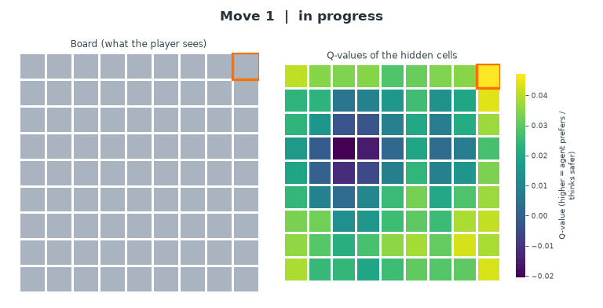
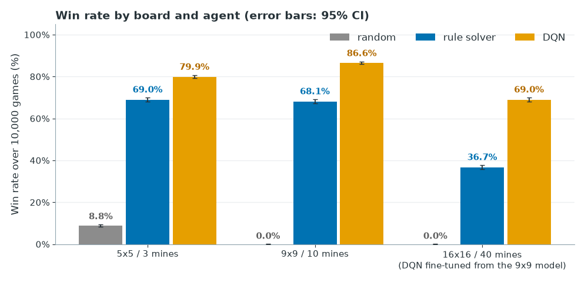
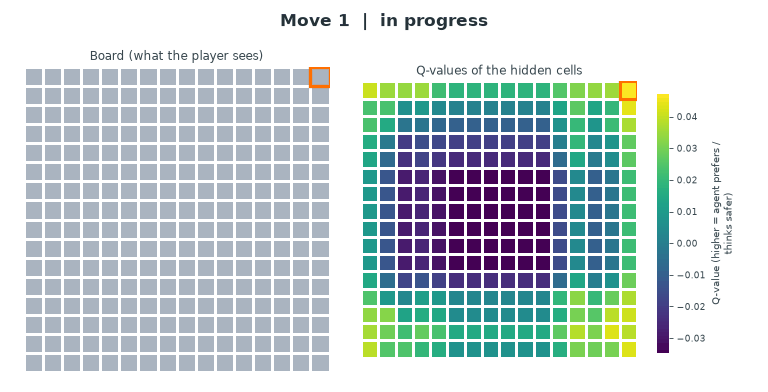
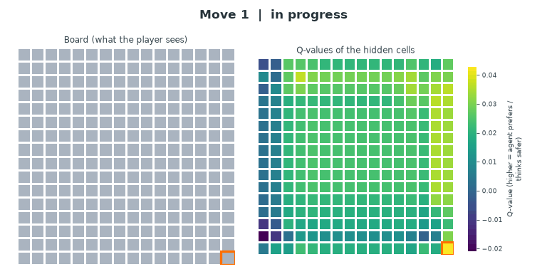
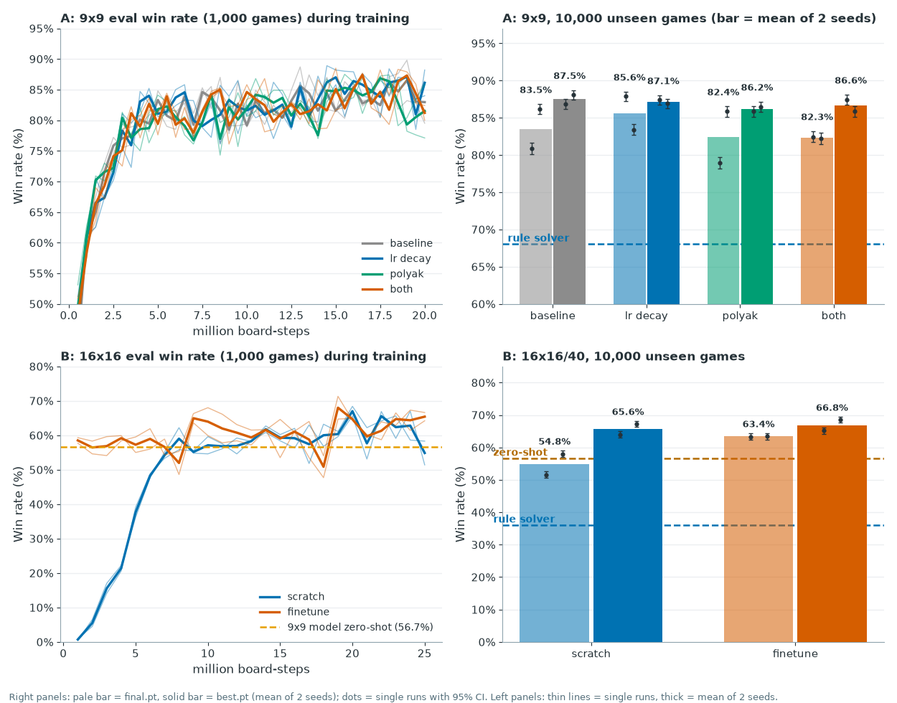

# MineSweeperAI

[](https://github.com/apih99/MineSweeperAI/actions/workflows/ci.yml)

**A Double-DQN agent that learns Minesweeper from scratch, with a fully convolutional network that plays any board size.**

**[Live demo: watch the agent play, or play yourself with hints](https://apih99.github.io/MineSweeperAI/)** (runs in your browser, no server)

- **9x9 / 10 mines: 86.6% win rate** (95% CI 85.9-87.2%) vs 68.1% for a hand-written deduction solver and ~0% for random clicking.
- **Zero-shot transfer:** the same weights, never trained on anything bigger, win **56.6%** of 16x16 / 40-mine games (rule solver: 36.7%).
- **Fine-tuned for 16x16:** continuing training of the 9x9 model on 16x16 boards lifts that to **68.5%** on 10,000 unseen seeds (best of 4 runs, see [Experiments](#experiments)); the web demo uses it for boards larger than 9x9.
- Trained in **~37 minutes on a free Kaggle T4**. Win rates are over 10,000 fixed-seed games.



*Left: the board as a player sees it. Right: the network's Q-value for every hidden cell (brighter = it thinks that cell is safer). The orange box is the cell it reveals next. Seed 5,000,000, never seen in training.*

## Results

Win rate over 10,000 games, 95% Wilson CI. Standard seeds are 1,000,000-1,009,999; unseen seeds are 5,000,000-5,009,999 (never used for training, model selection or learning-curve evals). The DQN rows use the `best.pt` checkpoint.

| Board | Random | Rule solver | DQN (standard seeds) | DQN (unseen seeds) |
|-------|--------|-------------|----------------------|--------------------|
| 5x5 / 3 mines | 8.82% (8.28-9.39%) | 68.96% (68.05-69.86%) | **79.93%** (79.13-80.70%) | - |
| 9x9 / 10 mines | 0.00% (0.00-0.04%) | 68.11% (67.19-69.02%) | **86.55%** (85.87-87.20%) | **87.57%** (86.91-88.20%) |
| 16x16 / 40 mines, **DQN fine-tuned on 16x16** | 0.00% (0.00-0.04%) | 36.69% (35.75-37.64%) | **68.97%** (68.06-69.87%) | **68.50%** (67.58-69.40%) |
| 16x16 / 40 mines, DQN trained on 9x9 only (zero-shot) | 0.00% (0.00-0.04%) | 36.69% (35.75-37.64%) | 56.63% (55.66-57.60%) | 56.70% (unseen seeds, from the experiments) |
| 5x5 / 3 mines, DQN trained on 9x9 only | - | - | 79.09% (78.28-79.88%) | - |



The fine-tuned 16x16 row is `models/dqn_16x16_40_finetune.pt`, the best checkpoint of the best of 4 fine-tuning/scratch runs (the 2 fine-tune runs reached 65.2% and 68.5%), so 68.5% is an optimistic pick; a typical run lands nearer 63-67%. An independent check on 3,000 fresh seeds (7,000,000 and up) gave **69.2%** (67.5-70.8%), against 57.8% for the 9x9 model on the same games. On the unseen seeds the rule solver wins 36.09%; the solver and random columns in the table are on the standard seeds. The chart shows the fine-tuned model for 16x16; the zero-shot row is in the table only.

Two caveats. First, `best.pt` is the checkpoint with the best 1,000-game eval during training, picked from 40 noisy evals on seeds that overlap the standard range, so the unseen-seed column is the fairer estimate. Second, the final checkpoint (`final.pt`, 20M steps) scores 79.50% / 80.05% (standard / unseen): late in training the eval win rate bounces between about 74% and 87% because the learning rate never decays. So the honest 9x9 summary is "about 87% at its best checkpoint, about 80% at the end"; see [what I learned](#what-i-learned).

## How it works

- **Environment.** Classic rules, reveal-only (no flags). The first click is always safe: mines are placed after it. Revealing a zero flood-fills. A single-board Gymnasium env is the reference; a vectorised NumPy env steps 256 boards at once and is tested to be bit-for-bit identical to it.
- **Observation.** A 10-channel one-hot grid: channel 0 = hidden, channels 1-9 = revealed number 0-8. Zero padding makes "off the board" look different from every real cell.
- **Action masking.** Already-revealed cells get Q = -inf both when acting and in the Double-DQN target's argmax, and random exploration only picks hidden cells. The agent can never waste a move or bootstrap from an illegal one.
- **Reward.** +1 win, -1 loss, +0.3 per safe reveal, nothing for the guaranteed-safe first click. Rewarding every safe reveal keeps the signal dense even though wins are rare early on.
- **Algorithm.** Double DQN (the online net picks the action, the target net scores it), replay buffer, epsilon-greedy decaying from 1.0 to 0.01 over the first quarter of training. **gamma = 0.1.** Minesweeper is nearly myopic: a move's value is mostly "is this cell safe, and how much does it open?", and the +0.3 per reveal already pays for progress, so a short horizon should train faster and more stably. That is a design bet, not a measured result; the gamma sweep (including 0) is a planned experiment.
- **Network.** Five 3x3 conv layers with 64 channels, then a 1x1 conv down to one channel: one Q-value per cell. No fully connected layers, no batch norm, about 150k parameters. Every layer is convolutional, so the same weights run on any board size; that is why the 9x9 model can be pointed at a 16x16 board unchanged. Five 3x3 layers see an 11x11 neighbourhood, plenty for Minesweeper's local deductions.
- **Training.** 20M board-steps on 256 parallel boards at about 9k board-steps/s on a Kaggle T4 (the NumPy env on the CPU is the bottleneck, not the GPU): **37 minutes** end to end.

## Learning curves


On both boards the agent passes the rule solver early (5x5 around 80k board-steps, 9x9 within about 2M) and then plateaus. The 9x9 curve is noisy because each point is a 1,000-game eval of a constant-learning-rate network.

## Watching it play (and lose)

The agent loses roughly 13% of 9x9 games. This loss is the first one on the unseen seeds, not a hand-picked one:


Here the agent never had a certainly-safe move: from the first moves on, the rule solver's two deduction rules find no safe cell at any of the 12 moves, and the Q-heatmap is a flat plateau of similar values (the fatal cell was among the best of them, about 0.3). Across 10,000 unseen-seed games ([results/dqn/loss_analysis_9x9_10.json](results/dqn/loss_analysis_9x9_10.json), `scripts/analyze_losses.py`) the agent lost 1,243 games, and in 1,123 of them (90%) the rule solver could not have found a safe cell at the fatal click either, so most losses are guesses. The other 120 (10%) are real misses. This only checks the two simple rules, not deeper logic, so it does not prove those guesses were unavoidable.

And the 9x9 network, never trained on a 16x16 board, solving one (the first zero-shot win on the unseen seeds):



And the fine-tuned 16x16 model on the same kind of board (first win on the unseen seeds, seed 5,000,000, 95 moves):



GIF seeds (scanning upward from 5,000,000 and taking the first game with each outcome, so nothing is cherry-picked beyond that): 9x9 win **5000000**, 9x9 loss **5000006**, 16x16 zero-shot win **5000001**, 16x16 fine-tuned win **5000000** (`python scripts/make_gifs.py --finetune`).

## What I learned

- **A correlated-RNG bug halved the baselines.** The first evaluation harness seeded the agent and the environment with bit-identical random streams, so the agents' random guesses were correlated with where the mines were. The rule solver scored about 37% instead of its true ~69%. I caught it by cross-checking against an exhaustive-logic solver, which should never do worse than a two-rule one; the fix gives the agent its own independent stream, and a regression test guards it (`tests/test_evaluate.py`). Lesson: a baseline that looks too weak is a bug report.
- **Exact resume.** Training survives being killed at any moment and continues bit-for-bit: weights, optimiser state, replay buffer, every RNG state and the logs are checkpointed atomically, and a test compares a straight 2k-step run with 1k steps + a fresh-process resume. That matters because free GPU sessions are capped at 12 hours.
- **Checkpoint selection is noisy.** The best checkpoint scores 86.6-87.6%, the final one 79.5-80.1%. Evals of consecutive checkpoints swing by more than their confidence intervals, so "best of 40" flatters the model; I report unseen seeds and the final checkpoint next to it. I tried learning-rate decay and soft target updates ([Experiments](#experiments)); neither reliably fixed it.
- **The ceiling is below 100%.** Some positions are genuine guesses (no cell is provably safe), so no agent wins every game. About 90% of the 9x9 losses came at a click where the two-rule solver also had no safe cell (see above).

## Experiments

Two follow-up experiments, run on a Kaggle T4 machine (2 GPUs, 4 CPU cores) after the main 9x9 run. All win rates below are over **10,000 unseen games** (seeds 5,000,000+, never used for training or for picking `best.pt`), with 95% Wilson CIs. The raw numbers are in [results/experiments/](results/experiments/) (per-run JSON, learning-curve CSVs, `summary_*.json`). I recomputed the headline checkpoints locally on CPU and got the identical games and results.



### A. Can learning-rate decay or soft target updates stabilise 9x9 training?

**Question.** The 9x9 run reached 86.6% at its best checkpoint but only 79.5% at the end, because the evaluation win rate swung between about 74% and 87% late in training. Does decaying the learning rate and/or soft (Polyak) target updates fix that?

**Setup.** Four variants, each trained with 2 seeds (0 and 1), 20M board-steps, everything else identical to `configs/9x9.yaml` ([configs/experiments/](configs/experiments/)): `baseline` (constant lr 3e-4, hard target copy every 1,000 updates), `lr_decay` (cosine from 3e-4 down to 5% of that over the run; I picked cosine over linear because it changes slowly at both ends, but did not test linear), `polyak` (tau = 0.005 applied every update, no hard copies) and `both`. Late-training stability is the mean and standard deviation of the 1,000-game eval win rate over the last 25% of evals (the last 10 of 40). That std includes about 1.1 points of pure sampling noise from a 1,000-game eval.

**Per run**


| Run | best.pt, 10k unseen | final.pt, 10k unseen | late evals (last 25%): mean +- std | min-max |
|---|---|---|---|---|
| 9x9_baseline_s0 | 86.9% (86.2%-87.5%) | 80.9% (80.1%-81.6%) | 83.5% +- 1.9% | 79.5%-86.3% |
| 9x9_baseline_s1 | 88.1% (87.4%-88.7%) | 86.2% (85.5%-86.8%) | 84.7% +- 3.2% | 80.3%-89.8% |
| 9x9_lr_decay_s0 | 87.4% (86.7%-88.0%) | 87.9% (87.2%-88.5%) | 84.8% +- 3.6% | 78.5%-88.4% |
| 9x9_lr_decay_s1 | 86.9% (86.2%-87.5%) | 83.4% (82.7%-84.1%) | 85.6% +- 1.9% | 83.4%-88.0% |
| 9x9_polyak_s0 | 85.8% (85.1%-86.5%) | 79.0% (78.2%-79.7%) | 83.0% +- 3.9% | 77.1%-87.0% |
| 9x9_polyak_s1 | 86.5% (85.8%-87.1%) | 85.8% (85.1%-86.5%) | 84.3% +- 3.1% | 79.1%-87.5% |
| 9x9_both_s0 | 87.5% (86.8%-88.1%) | 82.5% (81.7%-83.2%) | 83.3% +- 2.5% | 79.3%-87.1% |
| 9x9_both_s1 | 85.8% (85.1%-86.5%) | 82.2% (81.4%-82.9%) | 85.2% +- 2.9% | 80.0%-88.3% |

**Per variant** (mean of the 2 seeds; the individual seeds in brackets)


| Variant | best.pt | final.pt | late-eval mean | late-eval std (mean of seeds) |
|---|---|---|---|---|
| baseline | 87.5% (86.9%, 88.1%) | 83.5% (80.9%, 86.2%) | 84.1% | 2.6% |
| lr_decay | 87.1% (87.4%, 86.9%) | 85.6% (87.9%, 83.4%) | 85.2% | 2.8% |
| polyak | 86.2% (85.8%, 86.5%) | 82.4% (79.0%, 85.8%) | 83.6% | 3.5% |
| both | 86.6% (87.5%, 85.8%) | 82.3% (82.5%, 82.2%) | 84.3% | 2.7% |

**Result.** No variant is a clear winner. The best-checkpoint scores are all 86-88% and indistinguishable. For the final checkpoint, `lr_decay` has the highest mean (85.6% vs 83.5% for baseline), but the two seeds of every variant except `both` differ by 4-7 points, which is larger than the gap between variants; with 2 seeds I cannot call that gap real. Soft target updates did not help (nominally worse). No variant removed the late swings: the late-eval std stays at 2.6-3.5 points everywhere, well above the 1.1-point sampling noise, so checkpoint-to-checkpoint wobble is real under every setting. (Whether a lower final lr or a longer decay would calm it is untested.) Practical conclusion: keep picking `best.pt`, and treat the final checkpoint's 79-88% range as mostly seed luck rather than a property of these settings. The unseen-seed score of `best.pt` held up (86-88%), so the best-of-40 selection is not badly misleading.

### B. Does fine-tuning the 9x9 model on 16x16 beat zero-shot, and beat training from scratch?

**Setup.** The 9x9 model wins 56.7% of 16x16 / 40-mine games zero-shot. Experiment A found no clear winner, so both B variants use the baseline settings. `finetune` loads the weights of `models/dqn_9x9_10.pt` (weights only: fresh optimiser, replay and counters) and explores from epsilon = 0.1; `scratch` starts from random weights with the normal epsilon schedule (1.0 down to 0.01). Same 16x16 config, same budget of 25M board-steps (about 2.2 hours each on a T4), 2 seeds each.

**Per run**


| Run | best.pt, 10k unseen | final.pt, 10k unseen | late evals (last 25%): mean +- std | min-max |
|---|---|---|---|---|
| 16x16_finetune_s0 | 65.2% (64.2%-66.1%) | 63.3% (62.4%-64.3%) | 64.1% +- 2.9% | 59.2%-67.3% |
| 16x16_finetune_s1 | 68.5% (67.6%-69.4%) | 63.4% (62.5%-64.3%) | 62.6% +- 2.9% | 58.7%-66.5% |
| 16x16_scratch_s0 | 64.0% (63.1%-65.0%) | 51.6% (50.6%-52.6%) | 60.5% +- 7.1% | 51.4%-67.0% |
| 16x16_scratch_s1 | 67.2% (66.3%-68.1%) | 58.0% (57.0%-59.0%) | 62.9% +- 4.0% | 58.3%-68.4% |

**Per variant** (mean of the 2 seeds; the individual seeds in brackets)


| Variant | best.pt | final.pt | late-eval mean | late-eval std (mean of seeds) |
|---|---|---|---|---|
| finetune | 66.8% (65.2%, 68.5%) | 63.4% (63.3%, 63.4%) | 63.4% | 2.9% |
| scratch | 65.6% (64.0%, 67.2%) | 54.8% (51.6%, 58.0%) | 61.7% | 5.5% |

Reference on the same 10,000 unseen games: 9x9 model zero-shot **56.70%** (55.73-57.67%), rule solver **36.09%** (35.15-37.04%).

**Result.** Fine-tuning clearly beats zero-shot: the fine-tuned seeds finish at 63.3% and 63.4% (final) and reach 65.2% and 68.5% at their best checkpoint, 6.6-11.8 points above 56.7%, with 10k-game CIs of about 1 point. Against scratch the picture is subtler. The fine-tuned run starts at about the zero-shot level (~58% at the first eval) and wanders between roughly 50% and 70%, while scratch needs about 8M steps to catch up with zero-shot. By the end both reach about the same best-checkpoint score (66.8% vs 65.6%, within noise), but the final scratch checkpoints are worse and more erratic (51.6% and 58.0%; late-eval std 5.5 vs 2.9 points). My reading: fine-tuning gives a decent 16x16 agent roughly 8M steps sooner and a more reliable final checkpoint, but I did not show that it reaches a higher ceiling than scratch. Neither is converged (the 16x16 config's own budget is 50M steps) and both curves are still noisy at 25M.

### Limitations

- **Two seeds per cell.** The seed-to-seed spread (4-7 points for final checkpoints) is as large as most differences between settings. Read the A table as "no detectable effect", not "no effect".
- **`best.pt` is picked by 1,000-game evals**, so some best-of-N optimism remains. Unseen seeds remove the selection overlap, but the "best" columns still overstate what one fresh run would give.
- One lr schedule shape and one tau were tried. A gamma sweep, a guess penalty and a bigger network were out of scope.
- The 16x16 runs use half the budget of `configs/16x16.yaml`.

Compute: A (8 runs x 20M steps) took 2.6 h and B (4 runs x 25M steps) 4.4 h of Kaggle session time, two runs in parallel, one per GPU. Per-run speed with two in parallel was about 9.2k board-steps/s on 9x9 (same as the single run in M6) and 3.3k on 16x16, so the second GPU doubled throughput even with only 4 CPU cores. Together with a 15-minute throughput benchmark that is about 7.3 h of session time.

**Promoted model.** [models/dqn_16x16_40_finetune.pt](models/dqn_16x16_40_finetune.pt) is the `best.pt` of the fine-tune seed-1 run and is now the project's 16x16 model: **68.50%** (67.58-69.40%) on the 10,000 unseen 16x16 games (seeds from 5,000,000), versus 56.70% zero-shot and 36.09% for the rule solver. It was chosen as the best of four runs, so expect a typical fine-tuned model nearer 63-67%. A fresh check on 3,000 seeds from 7,000,000 gave 69.2% (67.5-70.8%), against 57.8% for the 9x9 model. The web demo uses it for boards larger than 9x9. The 9x9 model, its headline numbers and the 9x9 GIFs are unchanged.

## Reproduce

Windows PowerShell (Linux/macOS: the same steps with `source .venv/bin/activate`):

```powershell
py -V:3.12 -m venv .venv
.\.venv\Scripts\Activate.ps1
pip install torch --index-url https://download.pytorch.org/whl/cpu
pip install -e ".[dev]"
pytest                      # add -m "not slow" to skip the short training runs
```

```powershell
# play it yourself in the terminal (enter "row col"; q quits)
python -m minesweeper_rl.play --height 9 --width 9 --mines 10 --seed 0

# evaluate (10,000 fixed-seed games; the trained 9x9 checkpoint is committed)
python -m minesweeper_rl.evaluate --agent dqn --checkpoint models/dqn_9x9_10.pt --height 9 --width 9 --mines 10
python -m minesweeper_rl.evaluate --agent dqn --checkpoint models/dqn_9x9_10.pt --height 16 --width 16 --mines 40   # zero-shot
python -m minesweeper_rl.evaluate --agent rule --height 9 --width 9 --mines 10

# train 5x5 locally (~23 min on a laptop CPU), watch with TensorBoard
python -m minesweeper_rl.train --config configs/5x5.yaml
tensorboard --logdir runs

# train 9x9 on a free Kaggle T4 (needs the Kaggle CLI; the kernel clones this repo at a pinned commit)
git push origin main
python scripts/kaggle_run.py push --accelerator NvidiaTeslaT4
python scripts/kaggle_run.py wait
python scripts/kaggle_run.py output --version v1

# regenerate every chart and GIF
python scripts/make_figures.py          # docs/assets/*.png from results/
python scripts/make_gifs.py             # docs/assets/*.gif (first win / loss on unseen seeds)
python -m minesweeper_rl.render --checkpoint models/dqn_9x9_10.pt --height 9 --width 9 --mines 10 --seed 5000000 --out docs/assets/x.gif
```

More detail (batched-env benchmark, config keys, checkpoint formats, Kaggle workflow) is in [docs/NOTES.md](docs/NOTES.md); the original design is in [PLAN.md](PLAN.md).

## Web demo

The trained network is exported to ONNX and runs entirely in the browser with [onnxruntime-web](https://onnxruntime.ai/) (WebAssembly); there is no server. `web/` is a static site (vanilla JS modules, no build step): `game.js` is a port of the Python environment, `agent.js` runs the model and applies the action mask, `app.js` is the UI. You can watch the agent play, play yourself (long-press or right-click to flag; the Hint button shows the agent's choice) and overlay its Q-value heatmap. The ONNX model has dynamic height/width, so one file serves any board size; its output is raw Q-values of shape `(1, H*W)` and masking is done in JS. Two models ship: `dqn_9x9_10.onnx` for boards up to 9x9, and `dqn_16x16_40_finetune.onnx` (602 KiB) when either side is longer than 9. The 16x16 one is fetched lazily the first time it is needed and the session is cached; the page shows which model is active.

```powershell
pip install -e ".[dev,web]"
python scripts/export_onnx.py           # writes web/model/dqn_9x9_10.onnx and web/tests/fixtures.json
pytest tests/test_onnx_export.py        # ONNX vs PyTorch parity
node --test "web/tests/*.test.mjs"      # JS game logic vs Python fixtures
cd web; python -m http.server           # try it locally at http://localhost:8000
```

Pushes to `main` that touch `web/` deploy to GitHub Pages (`.github/workflows/pages.yml`). Seeds in the demo use a JavaScript generator and do not reproduce the Python boards.

## Project structure

```
configs/            YAML per run (5x5, 9x9, 16x16); experiments/ for M8
src/minesweeper_rl/
  env/              core.py (rules), gym_env.py (single board), batched.py (vectorised)
  agents/           network.py (5x64 FCN), dqn.py (Double DQN, replay, masking), baselines.py (random, rule)
  train.py  evaluate.py  render.py  play.py  checkpoint.py
tests/              rules, env equivalence, masking, resume, evaluation, rendering
scripts/            export_onnx.py, make_figures.py, make_gifs.py, kaggle_run.py, eval_run.py, experiments_collect.py, experiments_table.py, bench_env.py
kaggle/             kernel that trains on Kaggle
models/             dqn_9x9_10.pt (trained weights), dqn_16x16_40_finetune.pt (16x16 model, fine-tuned from the 9x9 one)
web/                static in-browser demo (ONNX models, JS game, UI, JS tests)
results/            baselines/, dqn/ and experiments/ JSON + learning-curve CSVs (the source of every number here)
docs/               assets/ (README images), NOTES.md
```

## Roadmap

- ~~M8, experiments~~ (done): lr decay / soft target updates on 9x9 and fine-tuning on 16x16, see [Experiments](#experiments). Not done: gamma sweep, a guess penalty, a bigger network, checkpoint averaging.
- ~~M9, browser demo~~ (done): see [Web demo](#web-demo).
